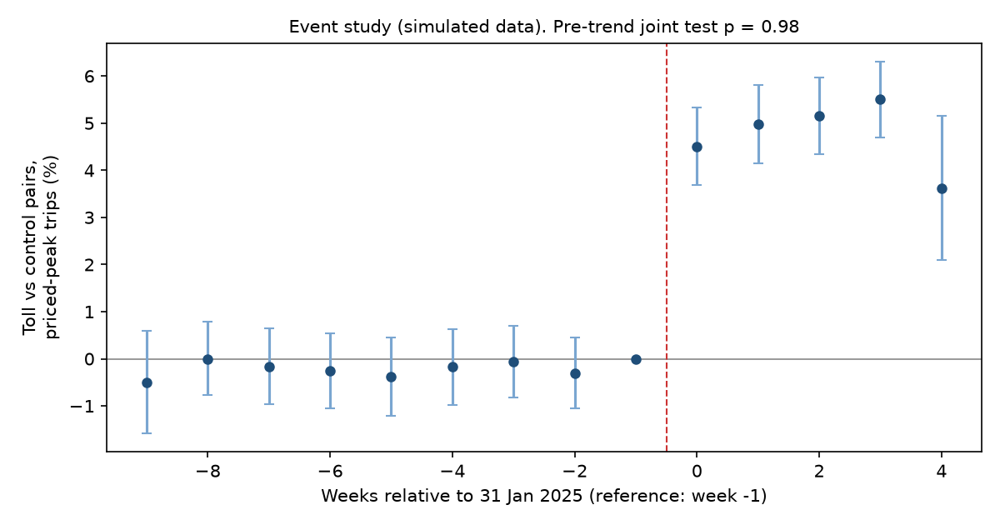
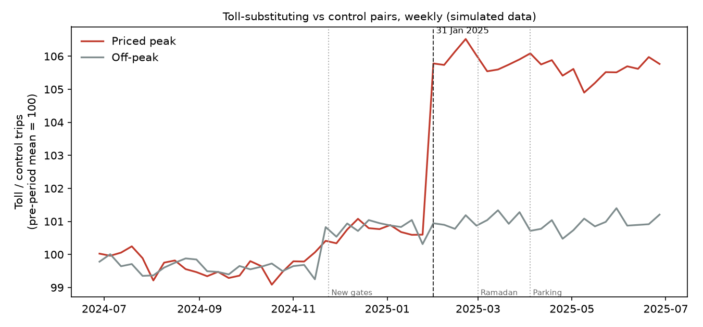

# Did Salik's Peak Pricing Push People onto the Metro?

A causal-inference study of Dubai's January 2025 Salik variable toll pricing and
Metro ridership, using difference-in-differences on station-to-station trips.

> ⚠️ **This is a simulation study. The ridership data is synthetic.**
> Real 2025 Metro ridership was not publicly available. The study generates a
> realistic simulated year of ridership with a **known, planted effect** and
> realistic traps (new toll gates, Ramadan, school holidays, a parking tariff
> change, an outage, a station rename). It then tests whether the causal
> methods recover the planted effect. **No result here is a finding about the
> real Dubai Metro.** The pipeline is built to run unchanged on real data.

## Headline

**The difference-in-differences design recovered the planted effect.** Peak-hour
trips on toll-substituting routes rose by **+5.2% (95% CI +4.8% to +5.5%)**,
with standard errors clustered by station pair. The true simulated effect was **+5.0%**.

| Check (pre-registered) | Result | Target | |
|---|---|---|---|
| Event-study pre-trends, joint test | p = 0.98 | p > 0.10 | ✅ |
| Placebo: fake change date | +0.14%, p = 0.51 | p > 0.05 | ✅ |
| Placebo: late-evening trips (not repriced) | +0.11%, p = 0.69 | p > 0.05 | ✅ |
| Counterfactual model accuracy (held-out weeks) | 99.3% | ≥ 85% | ✅ |

| Estimate | Result (95% CI) | Truth | Covers truth |
|---|---|---|---|
| **DiD, main window (headline)** | **+5.2% (+4.8 to +5.5)** | +5.0% | ✅ |
| Triple difference (toll × peak × after) | +4.8% (+4.3 to +5.3) | +5.0% | ✅ |
| DiD, full year + controls | +4.8% (+4.6 to +5.1) | +5.0% | ✅ |
| DiD, window before parking change | +5.1% (+4.8 to +5.5) | +5.0% | ✅ |
| Counterfactual forecast | +5.7% (+5.4 to +6.1) | +5.0% | ❌ |
| Interrupted time series (all trips) | −0.1% (−2.2 to +2.0) | +0.86% | ✅ (but can't detect it) |
| *Naive: toll-peak trips, whole year before vs after* | *+8.5%* | +5.0% | — |
| *Exploratory: DiD full year, no new-gate control* | *+6.1% (+5.9 to +6.3)* | +5.0% | ❌ |

**What this shows**
- A control group and the right window let DiD recover a ~5% effect that a
  naive before/after comparison overstates (+8.5%), and that a network-wide
  time series can't see at all.
- **Missing one confounder breaks it.** Without the control for the toll gates
  opened in November 2024, the estimate becomes +6.1% and the interval misses
  the truth.
- **An accurate forecast is not an unbiased one.** The counterfactual model was
  99.3% accurate on held-out weeks but still overshot (+5.7%), because its
  pre-registered predictors left out the November gate openings. It is reported
  as it came out. A fix with a gate term (+5.3%, CI 4.9 to 5.7) is shown
  separately as exploratory.

Full table: [`results/summary.md`](results/summary.md) · Memo:
[`report/memo.pdf`](report/memo.pdf) · Concepts: [`NOTES.md`](NOTES.md)




## The question

On 31 January 2025 Salik moved to variable pricing: AED 6 per crossing at
weekday peaks (6–10 am, 4–8 pm), AED 4 off-peak and all day Sunday, and free
late at night. Did this push trips onto the Metro, especially at peak hours and
on routes that would cross a toll gate by car?

## Method

1. **Label OD pairs.** A short screen line is drawn across the road at each
   Salik gate. A station pair is *toll-substituting* if the straight line
   between the stations crosses a screen line. Result: 674 of 1,260 ordered pairs.
2. **Interrupted time series** on total daily ridership (Newey-West errors).
3. **Difference-in-differences** with pair and date fixed effects, and an
   event study with weekly leads and lags. This is the pre-specified headline.
4. **Triple difference**: toll-substituting × priced peak × after, with Sundays
   and off-peak hours as built-in controls.
5. **Counterfactual forecast**, used only if it is at least 85% accurate on
   6 held-out pre-period weeks.
6. **Placebos** and **robustness windows**.

The windows, models and thresholds were fixed in [`config.yaml`](config.yaml)
and committed **before** any analysis ran (see the git history). Later
additions are labelled *exploratory*.


## Data

| File | What it is |
|---|---|
| `data/stations.csv` | 36 Metro stations (Red and Green Line subset), **approximate** coordinates |
| `data/gates.csv` | Salik gates with screen-line settings, **approximate** positions |
| `data/events.csv` | Holidays, Ramadan, school terms, gate openings, parking change, disruptions. **Approximate dates, used as simulation assumptions, not verified** |
| `data/od_labels.csv` | Toll-substituting labels per OD pair |
| `simulation.yaml` | Ground truth of the simulated world. Only `src/recovery.py` reads it, after all estimates are made |
| `data/processed/` | Simulated OD × date × hour trip counts (regenerated, not committed) |

## Reproduce

```bash
python -m venv .venv
.venv/Scripts/activate          # Windows;  source .venv/bin/activate on macOS/Linux
pip install -r requirements.txt

python run_all.py               # everything, about 40 seconds
pytest
```

`run_all.py` runs: labels → simulate → data checks → DiD/event study/triple
difference → ITS → counterfactual → placebos → recovery vs truth → memo
(Markdown + PDF). Resume from any step with `python run_all.py --from did`.
GitHub Actions runs the tests and the full study on every push.

**On real data:** set the column mapping in `schema.yaml`, aggregate the raw
files with `scripts/download_and_aggregate.py`, then run
`python run_all.py --skip-sim`. To see the pipeline work on a trip-level
file (it matches the simulator exactly):

```bash
python scripts/simulate_ridership.py --raw-days 2025-01-15
python scripts/download_and_aggregate.py run --start 2025-01-15 --end 2025-01-15 --out-dir demo_out
```

## Repo layout

```
run_all.py                   runs the whole study
config.yaml                  pre-registered analysis plan
simulation.yaml              simulated ground truth
schema.yaml                  raw-file column mapping
data/                        stations, gates, events calendar, OD labels
scripts/                     simulator, download/aggregate pipeline, data checks
src/                         labelling, panel, its, did, counterfactual, placebo, recovery
report/                      memo (md + pdf), figures, memo builder
results/                     JSON outputs, data checks, summary table
tests/                       19 tests
NOTES.md                     the causal-inference ideas, in plain language
```

## Limitations

Simulated data shows that the design *can* work, not what happened in Dubai.
The planted effect is clean (one size, peak only, labelled routes only). Real
effects vary by route, and straight-line labels misclassify some trips, which
pulls estimates towards zero. Station and gate positions and event dates are
approximate.

## License

MIT. See `LICENSE`.
