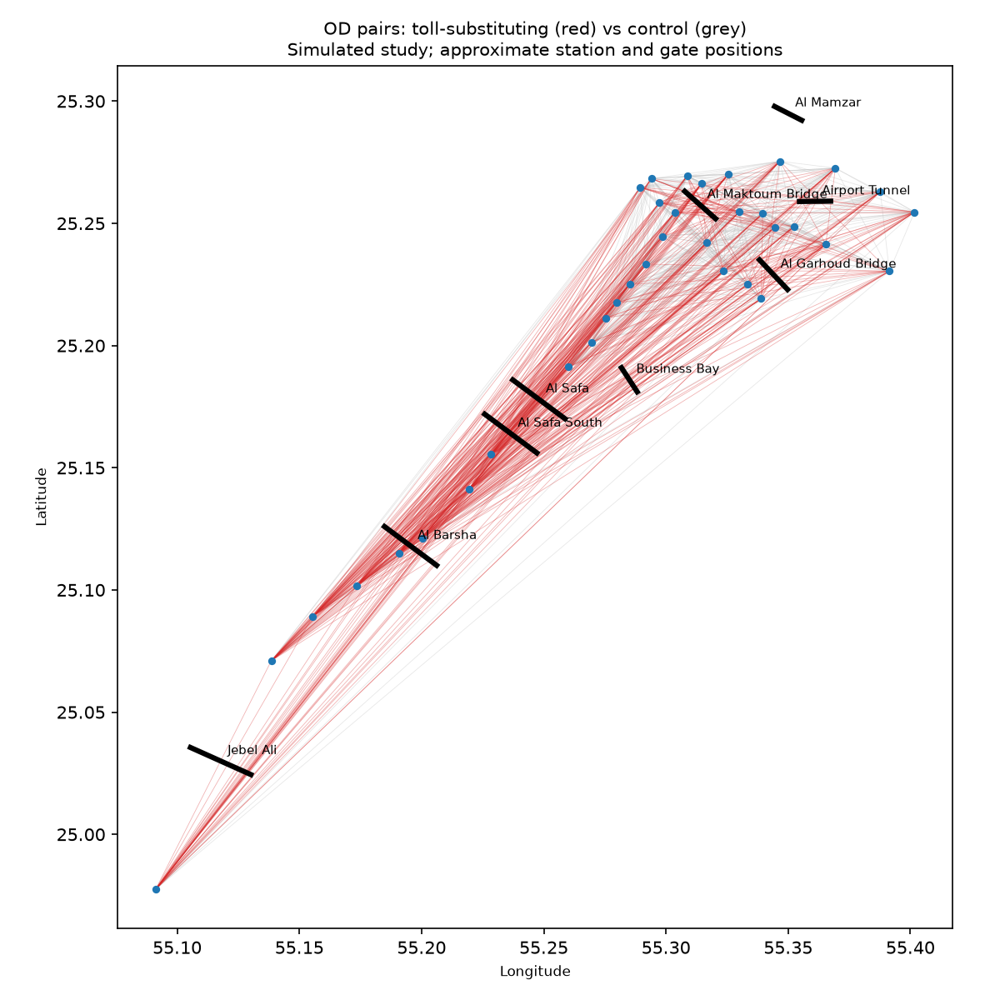

# Did Salik's Peak Pricing Push People onto the Metro?

A causal-inference study of Dubai's January 2025 Salik variable toll pricing and
Metro ridership, using difference-in-differences on station-to-station trips.

> ⚠️ **This is a simulation study. The ridership data is synthetic.**
> Real 2025 Metro ridership was not publicly available. The study generates a
> realistic simulated year of ridership with a **known, planted effect** and
> realistic traps (new toll gates, Ramadan, school holidays, a parking tariff
> change, an outage, a station rename). It then tests whether the causal
> methods recover the planted effect. **No result here is a finding about the
> real Dubai Metro.** The pipeline is built to run unchanged on real data.

> **Status: in progress.** Data, labels and the pre-registered analysis plan
> are done. The analysis is next.

## The question

On 31 January 2025 Salik moved to variable pricing: AED 6 per crossing at
weekday peaks (6–10 am, 4–8 pm), AED 4 off-peak and all day Sunday, and free
late at night. Did this push trips onto the Metro, especially at peak hours and
on routes that would cross a toll gate by car?

This is a cause-and-effect question. "Ridership went up after January" proves
nothing on its own: ridership grows over time and moves with seasons,
holidays and other policy changes.

## Why a simulation study

With synthetic data the true answer is known, so the study can show:

1. that the designs **recover the planted effect** (+5% on toll-substituting
   routes at priced peak hours) within their confidence intervals;
2. that **naive comparisons get it wrong** (a simple before/after picks up
   growth, seasonality and the new gates);
3. that the **validity checks** (event-study pre-trends, placebos, the
   counterfactual accuracy bar) behave as they should.

## Method

1. **Label OD pairs.** A short screen line is drawn across the road at each
   Salik gate. A station pair is *toll-substituting* if the straight line
   between the stations crosses a screen line (`src/label_od_pairs.py`).
   Result: 674 of 1,260 ordered pairs.
2. **Interrupted time series** on total daily ridership.
3. **Difference-in-differences** with an event study: toll-substituting pairs
   vs other pairs, at priced peak hours. This is the pre-specified headline.
4. **Triple difference**: toll-substituting × priced peak × after, with Sundays
   and off-peak hours as built-in controls.
5. **Counterfactual forecast check**, used only if it is at least 85% accurate
   on held-out pre-period weeks.
6. **Placebo tests** (fake change date, an outcome that should not move) and
   robustness windows.

The windows, models and pass/fail thresholds were fixed in `config.yaml` and
committed **before** any analysis was run.



## Data

| File | What it is |
|---|---|
| `data/stations.csv` | 36 Metro stations (Red and Green Line subset), **approximate** coordinates |
| `data/gates.csv` | Salik gates with screen-line settings, **approximate** positions |
| `data/events.csv` | Calendar: holidays, Ramadan, school terms, gate openings, parking change, disruptions. **Approximate dates, used as simulation assumptions, not verified** |
| `data/od_labels.csv` | Toll-substituting labels per OD pair |
| `simulation.yaml` | The simulated world's ground truth (planted effect, confounders, noise). The analysis never reads it |
| `data/processed/` | Simulated OD × date × hour trip counts (regenerated, not committed) |

## Reproduce

```bash
python -m venv .venv
.venv/Scripts/activate          # Windows;  source .venv/bin/activate on macOS/Linux
pip install -r requirements.txt

python src/label_od_pairs.py                         # labels + review map
python scripts/simulate_ridership.py                 # simulated year (~15 s)
python scripts/check_data.py --start 2024-07-01 --end 2025-06-30
pytest
```

To see the real-data pipeline work, generate a trip-level raw file and
aggregate it. The result matches the simulator exactly:

```bash
python scripts/simulate_ridership.py --raw-days 2025-01-15
python scripts/download_and_aggregate.py inspect data/raw/metro_ridership_20250115.csv
python scripts/download_and_aggregate.py run --start 2025-01-15 --end 2025-01-15 --out-dir demo_out
```

For real data, set the column mapping in `schema.yaml` and run
`download_and_aggregate.py run` over the real files instead of the simulator.

## Repo layout

```
config.yaml                  pre-registered analysis plan (windows, models, thresholds)
simulation.yaml              simulated ground truth
schema.yaml                  raw-file column mapping
data/                        stations, gates, events calendar, OD labels
scripts/                     simulator, download/aggregate pipeline, data checks
src/                         labelling, calendar and analysis
report/                      memo and figures
results/                     model outputs and check reports
tests/
```

## License

MIT. See `LICENSE`.
