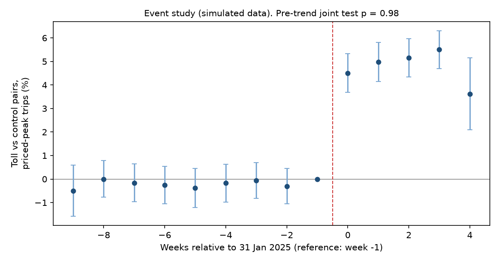
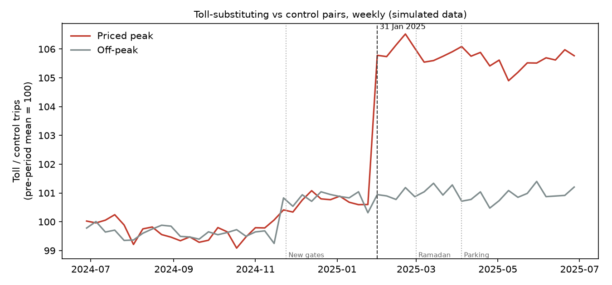

# Did Salik's peak pricing push people onto the Metro?

**A simulation study of the causal design.** *All ridership data in this memo is
simulated. No number here describes the real Dubai Metro.*

## Question

On 31 January 2025 Salik introduced variable pricing: AED 6 per crossing at weekday
peaks, AED 4 off-peak and on Sundays, and free late at night. Did this move car trips
onto the Metro, especially at peak hours on routes that would cross a toll gate?
Real 2025 Metro ridership was not publicly available. This study therefore builds a
realistic simulated year with a **known effect (+5% on toll routes at peak
hours)** and tests whether the method recovers it.

## Data (simulated)

A year (Jul 2024 to Jun 2025) of trips between 36 Red and Green Line stations,
counted by station pair, day and hour. The simulated city includes the things that
make the real question hard: ridership growth, a summer dip, holidays, school
breaks, Ramadan, **two new toll gates opening on 24 Nov 2024**, a parking tariff
change in April, plus an outage, a missing day and a station rename. The data checks
found all of these. Each station pair is labelled *toll-substituting* if the straight
line between its stations crosses a screen line drawn across the road at a Salik gate
(674 of 1,260 pairs).

## Method in plain words

The key comparison is **difference-in-differences**. Take the change in peak trips on
toll routes after 31 January, and subtract the change on routes that cross no gate.
Anything that hits both groups (growth, weather, holidays) cancels out, so what is
left is the effect of the toll. This only works if the two groups were moving in step
before the change. The **event study** checks this week by week. The **triple
difference** adds a third comparison: peak vs off-peak hours, with Sundays as
built-in controls, since the price rose only at weekday peaks. The analysis window
(1 Dec 2024 to 28 Feb 2025) starts after the new gates opened and ends before
Ramadan. It was written down and committed **before** any analysis ran.

## Headline result

**Peak-hour trips on toll-substituting routes rose by +5.2% (95% CI
+4.8% to +5.5%), with errors clustered by station pair.** The planted effect was
+5.0%, which the interval covers.
The triple difference gives +4.8% (+4.3% to +5.3%).

## Checks

| Check | Result | Target | |
|---|---|---|---|
| Counterfactual accuracy, held-out weeks | 99.3% | 85% or more | Pass |
| Event-study pre-trends, joint test | p = 0.98 | p > 0.10 | Pass |
| Placebo: fake change date (6 Jan) | +0.14%, p = 0.51 | p > 0.05 | Pass |
| Placebo: late-evening trips | +0.11%, p = 0.69 | p > 0.05 | Pass |

Robustness: the full-year window with controls gives
+4.8% (+4.6% to +5.1%).
The window ending before the parking change gives
+5.1%
(+4.8% to +5.5%).

## What the weaker designs show

- **Naive before/after** on toll-route peak trips: +5.2% over four weeks
  (close to the truth by luck, because nothing else changed in those weeks), but
  +8.5% over the whole year, mostly growth and seasons. Without a
  control group there is no way to tell which one to believe.
- **Forgetting a confounder:** the full-year DiD *without* the new-gate control gives
  +6.1% (+5.9% to +6.3%), and the interval misses the truth.
- **Interrupted time series** on all trips: -0.1%
  (-2.2% to +2.0%). The true effect on *all* trips is only
  +0.86%, too small to see in a single noisy series.
- **Counterfactual forecast:** The forecast model met the accuracy bar (99.3% on 6 held-out weeks), but its estimate, +5.7% (+5.4% to +6.1%), **misses the truth**. The pre-registered predictors left out the gates that opened on 24 Nov 2024, so the model under-predicts toll-route trips after they opened. Adding that step (exploratory) gives +5.3% (+4.9% to +5.7%). Passing an accuracy test does not make a model unbiased.

## Limitations

The data is simulated, so this shows the design *can* work, not what happened in
Dubai. The simulated effect is clean (one size, only at peak, only on labelled
routes). Real effects would vary by route, and some trips would be labelled wrongly,
which pulls estimates towards zero. Straight-line labels miss real road routes, so a
review of the map by someone who knows the roads is essential. Station and gate
positions and event dates are approximate.

## What it means for RTA

All pre-registered checks pass, and every difference-in-differences estimate recovers the planted effect; the forecast counterfactual does not.
At the noise levels assumed here, this design can detect a peak-price effect of a few
percent on toll-substituting routes. A simple before/after comparison or a network-wide trend
cannot. The two things that matter most are (1) a control group of routes the toll
does not touch, and (2) handling other changes on the same routes, above all the
November 2024 gate openings. To run it for real, RTA needs station-to-station
ridership for 2024 to 2025 at daily or hourly level. The pipeline is ready for it.
